  
  &nbsp;
  

 

  

 

<table align="center">
  <tr>
    <td align="center" width="140">
      
    </td>
    <td align="left">
      <b>Co-Founder of Mineral Studio — <i>"Ideas that become systems."</i></b> 
      Independent software studio in <b>Ecuador</b> building tailored business systems: electronic invoicing (SRI), management platforms, booking systems, workflow automations, and custom web applications.  
      &nbsp;&nbsp;
    </td>
  </tr>
</table>

### Personal Projects

<table align="center">
  <tr>
    <td align="center" width="50%">
      
    </td>
    <td align="center" width="50%">
      
    </td>
  </tr>
  <tr>
    <td align="center" width="50%">
      
    </td>
    <td align="center" width="50%">
      
    </td>
  </tr>
  <tr>
    <td colspan="2" align="center">
      
    </td>
  </tr>
</table>

### University Coursework (UTM)

<table align="center">
  <tr>
    <td align="center" width="50%">
      
    </td>
    <td align="center" width="50%">
      
    </td>
  </tr>
</table>

 

  

