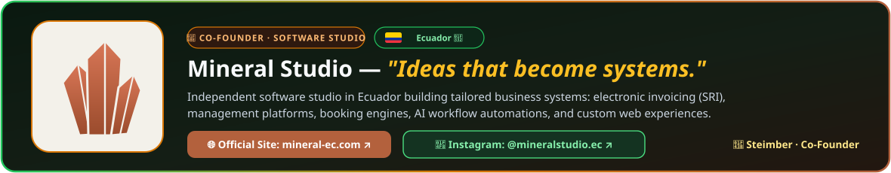
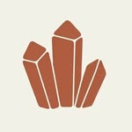
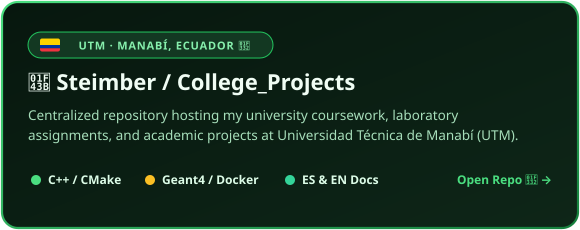
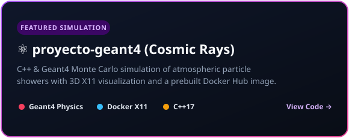
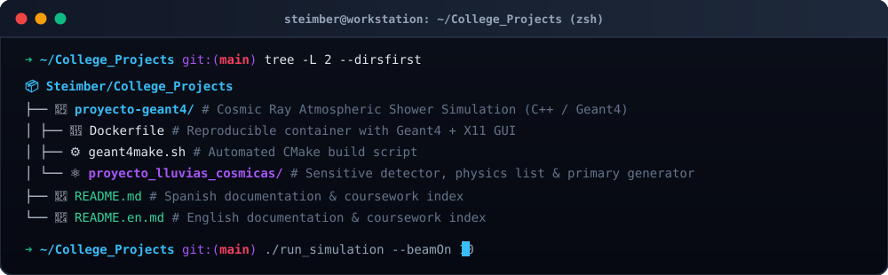

<!-- TOP NAVIGATION & LANGUAGE SWITCHER BAR (FOREST & BEAR THEME) -->

[-16a34a?style=for-the-badge&labelColor=07170e)](https://github.com/Steimber/Steimber/blob/main/README.en.md)

 

  

  

---

### 💎 Co-Founder of **Mineral Studio** 🇪🇨

  

<table align="center">
  <tr>
    <td align="center" width="140">
      
    </td>
    <td align="left">
      <b>💎 Mineral Studio — <i>"Ideas that become systems."</i></b> 
      Independent software studio in <b>Ecuador 🇪🇨</b> building tailored business systems: electronic invoicing (SRI), management platforms, booking systems, workflow automations, and custom web applications.  
      
      
    </td>
  </tr>
</table>

---

### 🌲 University Coursework & Projects — **UTM (Ecuador 🇪🇨)**

> 🐾 *All my coursework, laboratory assignments, and simulations at **Universidad Técnica de Manabí (UTM)** are centralized in the `College_Projects` repository:*

  
  

---

### 🖥️ Woodland Terminal (`~/College_Projects`)

  

---

### 🍃 Tech Stack & Tools

  

  

