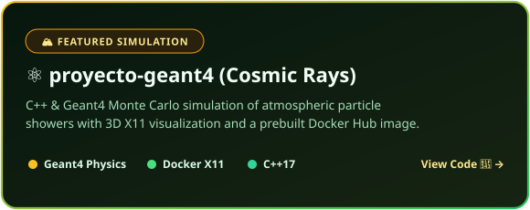

 

<b>Español</b>

 

  

 

<table align="center">
  <tr>
    <td align="center" width="140">
      
    </td>
    <td align="left">
      <b>💎 Co-Fundador de Mineral Studio — <i>"Ideas que se vuelven sistemas."</i></b> 
      Estudio independiente de software en <b>Ecuador</b> donde creamos sistemas a medida para negocios: facturación electrónica (SRI), gestión comercial, reservas, automatizaciones y sitios web.  
      
      
    </td>
  </tr>
</table>

### 🌲 Tareas Universitarias (UTM) & Proyectos

  
  

  

 

<b>English</b>

 

  

 

<table align="center">
  <tr>
    <td align="center" width="140">
      
    </td>
    <td align="left">
      <b>💎 Co-Founder of Mineral Studio — <i>"Ideas that become systems."</i></b> 
      Independent software studio in <b>Ecuador</b> building tailored business systems: electronic invoicing (SRI), management platforms, booking systems, workflow automations, and custom web applications.  
      
      
    </td>
  </tr>
</table>

### 🌲 University Coursework (UTM) & Projects

  
  

  

