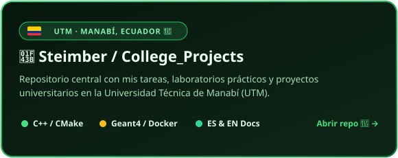
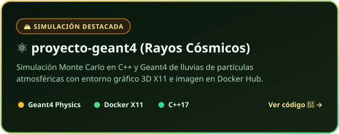
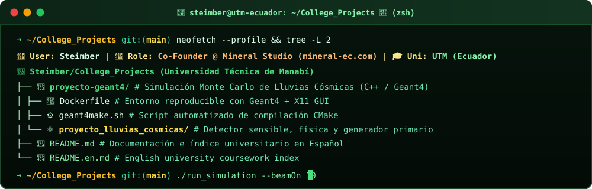

<!-- LANGUAGE SWITCHER BAR -->
[-0ea5e9?style=for-the-badge&labelColor=0f172a)](https://github.com/Steimber/Steimber/blob/main/README.md)

 

<b>🇪🇸 ESPAÑOL — Panel Principal Interactivo (Clic para contraer / desplegar)</b>

 

  

  

---

### 🚀 Proyectos Universitarios Destacados (`College_Projects`)

> 💡 *Haz clic en cualquiera de las tarjetas para ir directamente al repositorio o al código fuente del proyecto:*

  
  

---

### 🖥️ Explorador del Repositorio Universitario

  

---

### 🛠️ Stack Tecnológico y Herramientas

  

 

<b>🇺🇸 ENGLISH — Interactive English Dashboard (Click to expand / Switch to English inline)</b>

 

  

  

---

### 🚀 Featured University Projects (`College_Projects`)

> 💡 *Click on any card below to open the centralized university monorepo or inspect the simulation source code:*

  
  

---

### 🖥️ University Repository Explorer

  

---

### 🛠️ Tech Stack & Tools

  

  

